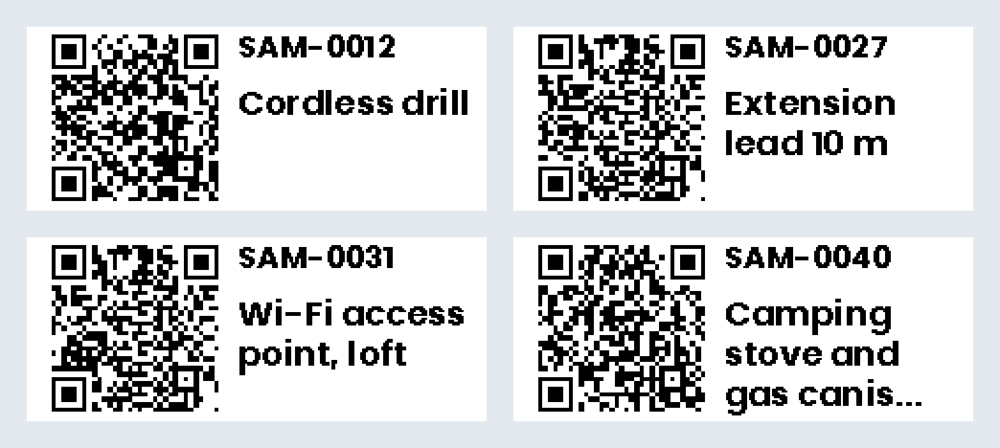
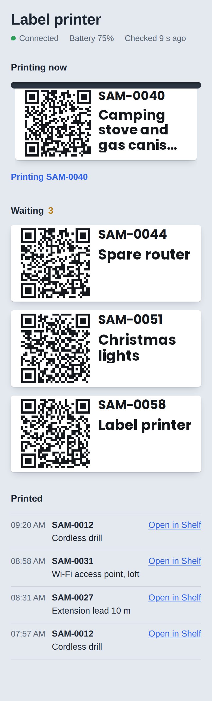
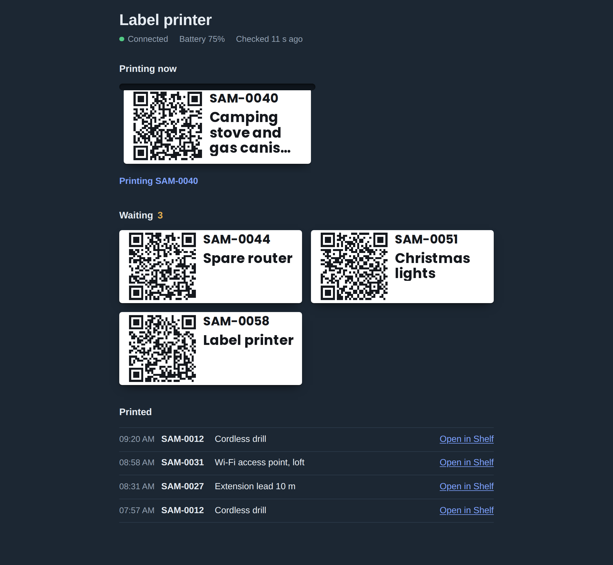

# Shelf → Niimbot labels

Print QR code labels for your [Shelf](https://github.com/Shelf-nu/shelf.nu) assets on a Niimbot label printer, just by tagging them.

<a href="https://github.com/VinneyUK/shelf-niimbot-labels/releases/latest"></a>
<a href="https://hits.sh/github.com/VinneyUK/shelf-niimbot-labels/"></a>

Give an asset the **QRP** tag in Shelf, and within a minute its label comes out of the printer. Once it's printed, the tag is swapped for **QRU**, so Shelf always shows which assets have a label. Tag one asset or fifty at once using Shelf's bulk actions.



Each label carries the asset's QR code, its ID and its name. The QR code is the same link Shelf's own labels use, so scanning one opens the asset and Shelf records the scan as normal.

An optional status page shows what's waiting, what's printing and what's been printed, along with the printer's battery and connection.

<p align="center">
  
  
</p>

## How it works

```
 Shelf ── tag "QRP" ──▶ shelf-labels.sh ── niimbot.print ──▶ Home Assistant ── Bluetooth ──▶ Niimbot
   ▲                      (every minute)                                                       │
   └──── tag swapped to "QRU" once Home Assistant confirms the print ◀─────────────────────────┘
```

A small bash script runs every minute. It reads Shelf's database for assets with the print tag, and sends each one to the [Niimbot integration](https://github.com/eigger/hass-niimbot) for Home Assistant, which handles the Bluetooth side. When Home Assistant confirms the print, the script swaps the tags.

If the printer is off or out of range, nothing is lost: the tag stays, and the label prints once the printer is back.

## Requirements

- **Shelf, self-hosted**, with its Postgres running in a Docker container on the same machine as this script. Shelf Cloud won't work, because the script reads Shelf's database directly.
- **Home Assistant** with the [Niimbot integration](https://github.com/eigger/hass-niimbot) set up and your printer added.
- **A Niimbot printer** the integration supports. Built and tested on a **D110** with 15×30 mm labels.
- **bash, curl and flock** on the machine running the script. Any Linux box has them, including Unraid.

Tested with Shelf 2.2.0 and version 4.1.0 of the Niimbot integration.

## Setup

**1. Create two tags in Shelf:** `QRP` (print this) and `QRU` (has a label). You can use other names; see [Settings](#settings).

**2. Get two things from Home Assistant:**

- A **long-lived access token**: your profile (bottom left) → **Security** → **Long-lived access tokens** → **Create token**.
- The printer's **device ID**: **Settings → Devices & services → Devices** → your Niimbot. It's the long string at the end of the page address.

**3. Download this repo** onto the machine running Shelf, and fill in the settings:

```sh
git clone https://github.com/VinneyUK/shelf-niimbot-labels.git
cd shelf-niimbot-labels
cp label-printer.env.example label-printer.env
chmod 600 label-printer.env
nano label-printer.env
```

At minimum, set `SHELF_URL`, `HA_URL`, `HA_TOKEN` and `NIIMBOT_DEVICE_ID`. If your Shelf database container isn't called `shelf-db`, set `DB_CONTAINER` too: `docker ps` lists the names.

**4. Test it,** with one asset tagged `QRP`:

```sh
./shelf-labels.sh --list      # shows what would print; changes nothing
./shelf-labels.sh --preview   # renders the label in Home Assistant without printing
./shelf-labels.sh             # prints it
```

After `--preview`, open your Niimbot device in Home Assistant and look at the **Last Label Made** image to check the layout.

**5. Run it every minute.** With cron:

```
* * * * * /path/to/shelf-niimbot-labels/shelf-labels.sh
```

On Unraid, use the **User Scripts** plugin: add a script containing the line above (without the five stars), and set its schedule to **Custom** with `* * * * *`.

## Status page

The script writes its status into `data/labels/`. The page in `page/` reads those files and refreshes every few seconds. It never talks to Shelf or Home Assistant itself, and holds no secrets.

To serve it with Docker:

```sh
docker compose -f docker-compose.status-page.yml up -d
```

Then open `http://<your server>:8088`. Change the port in `docker-compose.status-page.yml` if 8088 is taken.

Any web server works instead: serve `page/` as the site, with `data/labels/` available at `/data/`.

## Settings

All in `label-printer.env`:

| Setting | Default | What it does |
| --- | --- | --- |
| `SHELF_URL` | — | The address you open Shelf at. Must match Shelf's own `SERVER_URL`, because every QR code links to it. |
| `HA_URL` | — | Home Assistant's address, e.g. `http://homeassistant.local:8123` |
| `HA_TOKEN` | — | Home Assistant long-lived access token |
| `NIIMBOT_DEVICE_ID` | — | The printer's device ID in Home Assistant |
| `TAG_NAME` | `QRP` | The tag that means "print a label for this" |
| `DONE_TAG` | `QRU` | The tag added after printing. Leave blank to add nothing. |
| `LABEL_WIDTH` | `320` | Label length in printer dots, 8 per mm: `240` for 30 mm, `320` for 40 mm |
| `LEFT_MARGIN` | `8` | Space before the QR code, in dots. `8` is 1 mm. |
| `ROTATE` | `90` | Set to `270` if labels print upside down |
| `DENSITY` | printer default | Print darkness |
| `DB_CONTAINER` | `shelf-db` | Shelf's Postgres container |
| `DB_USER` / `DB_NAME` | `postgres` | How to log in to Postgres from inside that container |

**Label sizes.** The D110's printhead is 12 mm (96 dots), so that's the printable height whatever the tape width. On 15 mm tape you'll get a narrow unprinted strip along one edge. Shorter labels automatically get slightly smaller text so more of the name fits. Long names are cut short with "…".

## Reprinting

Add the `QRP` tag again. It doesn't matter that the asset already has `QRU`.

## Troubleshooting

The status page says what's wrong in most cases. For more detail:

```sh
grep shelf-labels /var/log/syslog | tail -20
```

- **Nothing prints, and the page says the script hasn't run.** Check the cron job or User Scripts schedule.
- **"Couldn't read Shelf's database."** Check `DB_CONTAINER` matches a name in `docker ps`.
- **"Home Assistant couldn't print it."** The printer is off, asleep or out of Bluetooth range. It'll retry every minute.
- **Text upside down:** `ROTATE=270`. **Wrong length:** `LABEL_WIDTH`.
- **Printer shows "Not connected right now" between prints.** That's normal: the integration only connects while printing, unless you turn on **Keep Connection** in its options.

## What it changes in Shelf

Shelf has no API for this, so the script edits Shelf's database directly. It only ever touches the link between an asset and its tags (the `_AssetToTag` table): removing the print tag and adding the done tag, in a single statement, after Home Assistant confirms the print. It never changes or deletes assets, tags or anything else.

Because it relies on Shelf's internal table layout, a future Shelf release could change something it depends on. If it ever stops finding tagged assets after a Shelf upgrade, that's the first thing to suspect. Back up Shelf's database as you normally would.

## Credits

- [Shelf](https://github.com/Shelf-nu/shelf.nu), the asset manager this is for
- [hass-niimbot](https://github.com/eigger/hass-niimbot) and [imagespec](https://github.com/eigger/imagespec) by eigger, which do the printing and rendering
- The status page bundles [QR Code Generator](https://github.com/kazuhikoarase/qrcode-generator) by Kazuhiko Arase (MIT), and the [Poppins](https://github.com/itfoundry/Poppins) font (SIL Open Font License, see `page/OFL.txt`), the same font the labels are printed in.

## Licence

MIT. See [LICENSE](LICENSE).
